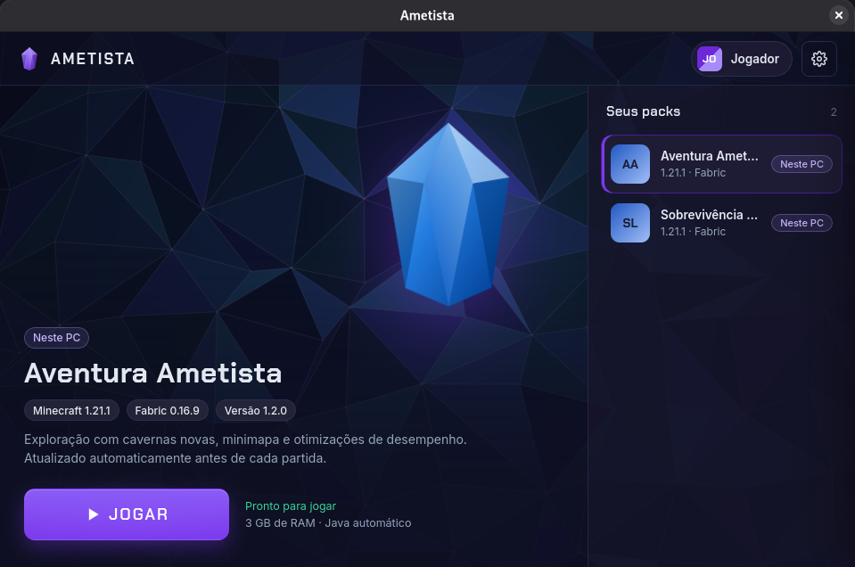

# Ametista

**A lightweight launcher for Minecraft: Java Edition, with official Microsoft login and curated, auto-updating modpacks.**

**Download:** https://luizfps120hz.github.io/ametista-launcher/

## Features

- **Official Microsoft account login.** OAuth 2.0 Authorization Code flow with PKCE in your
  own browser (tenant `consumers`), then Xbox Live → XSTS → Minecraft services: login, game
  ownership check and profile.
- **Remembers your session.** Refresh tokens are kept in the operating system's credential
  store, so you don't sign in every time.
- **Installs everything for you.** Game files come from Mojang's official version manifest,
  with SHA-1 verification of every file. Fabric is supported, and the right Java version is
  detected or downloaded (Eclipse Temurin, via Adoptium).
- **Curated packs, no marketplace.** Players only get the packs published by the maintainer.
  Each pack uses the [packwiz](https://packwiz.infra.link/) format and is synced before every
  launch, in its own game folder.
- **Light.** Built with Rust and Tauri, using the system webview. While you play, the launcher
  stays idle.
- **Linux and Windows.**

## How login works

Ametista is a **public client**: it has no client secret and it never sees your password.

1. Ametista opens `login.microsoftonline.com` in your browser, with a PKCE challenge.
2. You sign in on Microsoft's page, which redirects back to a temporary listener on
   `http://localhost` on your own computer.
3. Ametista exchanges the code for tokens (`XboxLive.signin offline_access`), then gets the
   Xbox Live, XSTS and Minecraft tokens, and checks game ownership and your profile.

## Privacy

- **Your password never passes through Ametista.** You type it only on Microsoft's website.
- **Tokens stay on your computer**, in the OS credential store (Secret Service on Linux,
  Credential Manager on Windows). There is no Ametista server and no telemetry.
- Ametista only talks to Microsoft, Xbox Live, Mojang/Minecraft services, Fabric, Adoptium
  and the pack catalog.
- Signing out deletes every stored token.

## Offline accounts

**Offline ("cracked") accounts are not supported.** You need a Microsoft account that owns
Minecraft: Java Edition.

## Requirements

| | |
|---|---|
| Windows | Windows 10 or 11, 64-bit (`.exe` or `.msi` installer) |
| Linux | x86_64, `.AppImage` (any distro) or `.deb` (Debian/Ubuntu) |
| Memory | 4 GB RAM or more (8 GB for bigger packs) |
| Account | Microsoft account that owns Minecraft: Java Edition |

Java is downloaded automatically when needed.

## Download

Get the latest version on the [download page](https://luizfps120hz.github.io/ametista-launcher/)
or in [Releases](https://github.com/LuizFps120hz/ametista-launcher/releases).

---

## Em português

**Ametista** é um launcher leve para o Minecraft: Java Edition, para Linux e Windows.

- Login **oficial** com conta Microsoft, no navegador do sistema. A **senha nunca passa pelo
  launcher** e os tokens ficam **só no seu computador**.
- Baixa o jogo direto da Mojang (com verificação de hash), instala o Fabric e o Java certo e
  atualiza os mods do pack automaticamente antes de cada partida.
- **Sem loja de mods:** você recebe os packs escolhidos pelo mantenedor.
- **Contas offline/piratas não são suportadas.**
- **Download:** https://luizfps120hz.github.io/ametista-launcher/

---

**Not an official Minecraft product. Not approved by or associated with Mojang or Microsoft.**
